# Plan: database v2 — accounts, student accounts, student v1 and v1.5 (Stage D0)

Stage D0 plan, 2026-10-16, for Ahmed's brief "database phase, built and tested locally". **Nothing here is built yet.** D1 builds it on the branch `db/local-v2`, against the local Docker Postgres only; nothing is merged into `main` (which deploys to Railway and migrates there) until Ahmed says so.

Read with: [docs/06](../06-data-model.md) (conventions, policy codes), [docs/10](../10-security-privacy.md) (roles, consent, retention), [auth-map-staging.md](auth-map-staging.md) §1–§4 (group A comes from there). Where this plan departs from a doc or the brief, §9 says so and why; the decisions waiting for Ahmed are in §10.

**Conventions kept** (docs/06 §0): UUIDv7 keys made by the app; `snake_case`; `text` + CHECK for enums; `_at` timestamptz, `_on` dates; plain `uuid` across schemas (no FK), real FKs inside one schema; `centre_id NOT NULL` on every tenant row, copied from the parent row by a trigger; append-only tables have a trigger that refuses UPDATE/DELETE and no grants for them; `UNIQUE NULLS NOT DISTINCT` wherever a key column can be NULL. Every new table gets RLS (`test/rls/schema.test.ts` fails otherwise) and every new `{id}` path joins the API sweep (`test/rls/api.test.ts` fails otherwise).

---

## 1. ERD (new and changed tables, linked to the existing ones)

Existing tables are shown with their keys only; **new** tables are marked `NEW`, changed ones `CHANGED`. Cross-schema links are plain `uuid` columns (no FK), drawn here for reading.

```mermaid
erDiagram
  %% ── A. Accounts and sign-in ─────────────────────────────
  identity_users ||--o{ identity_user_identities : "signs in with"
  identity_users ||--o{ identity_auth_sessions : "has"
  identity_users ||--o{ identity_role_assignments : "holds"
  identity_users ||--o| identity_student_accounts : "is (student users only)"
  org_students ||--o| identity_student_accounts : "has at most one"
  identity_student_accounts ||--o{ identity_student_access_codes : "parent makes"
  identity_student_accounts ||--o| identity_student_devices : "bound to (one live)"
  identity_student_devices ||--o{ identity_auth_sessions : "student sessions"
  org_guardians ||--o{ org_student_guardians : ""
  org_students ||--o{ org_student_guardians : ""
  org_consent_versions ||--o{ org_consent_events : "version of"
  org_students ||--o{ org_consent_events : "about (per child)"

  identity_users {
    uuid id PK
    text account_type "NEW adult|student"
    bytea phone_hmac "CHANGED nullable"
    bytea phone_enc "CHANGED nullable"
    text active_role "NEW"
    uuid active_centre_id "NEW"
  }
  identity_user_identities {
    uuid id PK "NEW"
    uuid user_id FK
    text provider "phone|email|google"
    bytea subject "HMAC, UNIQUE with provider"
    bytea contact_enc
    text hint
  }
  identity_access_allowlist {
    uuid id PK "NEW"
    text kind "email|phone"
    bytea subject "HMAC"
    text audience "app|ops"
  }
  identity_auth_sessions {
    uuid id PK
    text amr "NEW phone|email|google|student_pin"
    timestamptz authenticated_at "NEW"
    uuid student_device_id "NEW"
  }
  identity_student_accounts {
    uuid student_id PK "NEW"
    uuid user_id UK
    uuid guardian_id
    text status "awaiting_device|active|paused|locked"
    smallint failed_pin_count
  }
  identity_student_access_codes {
    uuid id PK "NEW"
    uuid student_id
    bytea code_hmac UK
    timestamptz expires_at "created + 10 min"
    timestamptz used_at
  }
  identity_student_devices {
    uuid id PK "NEW"
    uuid student_id
    bytea secret_hash
    text pin_hash
    timestamptz revoked_at
  }
  org_consent_versions {
    text kind PK "NEW"
    text version PK
    boolean approved
  }

  %% ── B. Student v1 ─────────────────────────────────────────
  market_groups ||--o{ market_group_sessions : ""
  market_group_sessions ||--o{ market_session_changes : "change log"
  market_rooms ||--o{ market_group_sessions : "room_id override (NEW)"
  identity_users ||--o{ messaging_in_app_notifications : "receives"
  market_group_sessions ||--|| records_session_records : ""
  records_session_records ||--o{ records_record_corrections : "record-level fixes"
  records_session_records ||--o{ records_homework_items : "homework set"
  records_homework_items ||--o{ records_homework_statuses : "per student"
  org_students ||--o{ records_homework_statuses : ""
  org_students ||--o{ market_makeup_requests : "asks"
  market_group_sessions ||--o{ market_makeup_requests : "missed / make-up"
  org_students ||--o{ records_student_notes : "for"

  market_group_sessions {
    uuid id PK
    uuid room_id "NEW nullable override"
  }
  market_session_changes {
    uuid id PK "NEW append-only"
    uuid group_session_id
    text kind "moved|cancelled|room_changed"
  }
  messaging_in_app_notifications {
    uuid id PK "NEW"
    uuid user_id
    text kind
    timestamptz read_at
  }
  records_session_records {
    uuid id PK
    text topic_covered "NEW"
    text homework_set "NEW"
  }
  records_record_corrections {
    uuid id PK "NEW append-only"
    uuid session_record_id
    text field
  }
  records_homework_items {
    uuid id PK "NEW"
    uuid session_record_id
    text title
  }
  records_homework_statuses {
    uuid homework_item_id PK "NEW"
    uuid student_id PK
    text status "set|handed_in|late"
  }
  market_makeup_requests {
    uuid id PK "NEW"
    uuid student_id
    uuid missed_session_id
    text status "requested|accepted|declined|withdrawn"
  }
  records_student_notes {
    uuid id PK "NEW"
    uuid student_id
    text status "draft|submitted|approved|rejected"
  }

  %% ── C. Student v1.5 ───────────────────────────────────────
  ref_subjects ||--o{ ref_topic_templates : "topic map"
  ref_topic_templates ||--o{ ref_topic_template_nodes : "units and topics"
  ref_topic_template_nodes ||--o{ ref_topic_template_nodes : "unit → topic"
  records_session_records ||--o{ records_session_topics : "covered"
  ref_topic_template_nodes ||--o{ records_session_topics : ""
  records_assessment_items ||--o{ analytics_item_topics : "tagged"
  ref_topic_template_nodes ||--o{ analytics_item_topics : ""
  records_item_scores }o--|| records_assessment_items : ""
  org_students ||--o{ analytics_topic_score_snapshots : "monthly"
  org_students ||--o{ analytics_focus_plans : "weekly"
  analytics_focus_plans ||--o{ analytics_focus_plan_items : "checklist"

  ref_topic_templates {
    uuid id PK "NEW (docs/06 §2)"
    uuid subject_id
    text academic_year
    text status "draft|published"
  }
  ref_topic_template_nodes {
    uuid id PK "NEW (docs/06 §2)"
    uuid template_id FK
    uuid parent_id FK
    text kind "unit|topic"
  }
  records_session_topics {
    uuid session_record_id PK "NEW"
    uuid topic_node_id PK
  }
  analytics_item_topics {
    uuid assessment_item_id PK "NEW (docs/06 §9)"
    uuid topic_node_id PK
  }
  analytics_topic_score_snapshots {
    uuid id PK "NEW append-only"
    date month
    numeric score
    smallint quiz_count
  }
  analytics_focus_plans {
    uuid id PK "NEW (docs/06 §9)"
    date week_of
    text status
  }
  analytics_focus_plan_items {
    uuid id PK "NEW"
    text text_ar
    timestamptz ticked_at "student writes"
  }
```

The topic score itself is **not a table**: it is the view `analytics.student_topic_scores` (§2.C), computed from confirmed marks on every read, so it can never drift from the records.

---

## 2. Data dictionary

Columns: **Type** · **RLS read / write** (codes from docs/06 §0, plus the new `STUDENT` = `student_id = platform.ctx_student_id()`) · **PII** · **Kept** (per docs/10 §4; "account" = while the account is active, the docs/10 default for records, notes and analytics, TBD with counsel). `created_at` / `updated_at` are on every table and not repeated.

### A. Accounts and sign-in

#### identity.users — CHANGED
| Column | Type | Read / write | PII | Kept |
|---|---|---|---|---|
| account_type **(new)** | text NOT NULL DEFAULT `'adult'`, CHECK `adult \| student` | SELF, OPS / SYSTEM only (set at creation) | no | account |
| phone_hmac, phone_enc, phone_last4 **(now nullable)** | bytea, bytea, text | as today | phone_enc **yes** | account |
| active_role **(new)** | text NULL, CHECK in the role list | SELF / SELF (through `PUT /v1/me/active-role`, checked against held roles) | no | account |
| active_centre_id **(new)** | uuid NULL | SELF / SELF | no | account |

Checks: `account_type = 'student' ⇒ phone_hmac IS NULL AND phone_enc IS NULL AND phone_last4 IS NULL` (**no student phone, ever**). An adult with a `phone` identity keeps `users.phone_*` equal to it (constraint trigger, auth-map-staging §1). A student user's `name` is NULL: the name lives once, on `org.students.display_name`.

#### identity.user_identities — NEW (auth-map-staging §1, unchanged)
| Column | Type | Read / write | PII | Kept |
|---|---|---|---|---|
| id | uuid PK | | | |
| user_id | uuid FK → users | SELF (masked view) / SYSTEM | no | account |
| provider | text CHECK `phone \| email \| google` | SELF, OPS (masked view) | no | account |
| subject | bytea NOT NULL — HMAC (`HMAC_KEY_LOOKUP`) of the normalised phone, email or Google `sub`; `UNIQUE (provider, subject)` | **nobody** as `app_user`; lookup through a SECURITY DEFINER function | pseudonymous | account |
| contact_enc | bytea NULL — envelope-encrypted phone or email (NULL for Google) | **nobody** as `app_user`; decrypted only to send | **yes** | account |
| hint | text NOT NULL — `•••• 0003`, `a•••@gmail.com` | SELF, OPS | masked | account |
| verified_at, last_used_at | timestamptz | SELF | no | account |

A trigger refuses any row whose user is `account_type = 'student'` (**no Google, email or phone sign-in for students**). Backfill: one `phone` identity per existing user from `users.phone_*`.

#### identity.access_allowlist — NEW (auth-map-staging §1, unchanged)
`id`, `kind` (`email \| phone`), `subject` bytea (HMAC), `hint`, `note` (≤ 200), `audience` (`app \| ops`), `added_by`, `used_at`, `removed_at`. `UNIQUE NULLS NOT DISTINCT (kind, subject, audience) WHERE removed_at IS NULL`. Read/write: `OPS` (`ops.verify`), `SYSTEM`. PII: `hint` masked, `note` must not hold contact details (ops screen says so). Kept: until removed + 90 days, then deleted.

#### identity.auth_sessions — CHANGED
| Column | Type | Notes |
|---|---|---|
| amr **(new)** | text NULL, CHECK `phone \| email \| google \| student_pin` | How this sign-in was proved; NULL for sessions older than the migration |
| authenticated_at **(new)** | timestamptz NULL | "Recent sign-in" check (10 min) before adding or removing a method |
| student_device_id **(new)** | uuid NULL FK → student_devices | Set for every student session; revoking the device revokes its sessions |

RLS unchanged (`SELF`, `SYSTEM`). Kept: as today (expired sessions deleted after 30 days).

#### org.consent_versions — NEW
The register of consent texts, so every consent row names a text that exists.

| Column | Type | Read / write | PII | Kept |
|---|---|---|---|---|
| kind | text, PK part | PUBLIC / OPS | no | forever |
| version | text, PK part (e.g. `draft-2026-10`) | PUBLIC / OPS | no | forever |
| text_sha256 | bytea NULL — hash of the exact Arabic + English text shown | PUBLIC / OPS | no | forever |
| approved | boolean NOT NULL DEFAULT false — `false` = draft (OD-60) | PUBLIC / OPS | no | forever |
| published_at, retired_at | timestamptz | PUBLIC / OPS | no | forever |

Backfilled with every `(kind, version)` already used (`draft-2026-10`, `c01-draft-2026-10`, …), then `org.consent_events (kind, version)` gets a FK to it. **New consent kind `student_account`**: the guardian agrees that this child gets a student account (recorded with `student_id`, `source = 'student_account'`). The current state per person and per child stays "the latest row per `(COALESCE(user_id, guardian_id), student_id, kind)`", never cached (docs/06 §3).

#### identity.student_accounts — NEW
One per child at most. **Only a guardian of that child can create it.**

| Column | Type | Read / write | PII | Kept |
|---|---|---|---|---|
| student_id | uuid PK (→ org.students) | STUDENT (own, status only), GUARDIAN, OPS / GUARDIAN (create, pause, resume, sign out everywhere — via SECURITY DEFINER functions only) | no | account |
| user_id | uuid UNIQUE FK → users (`account_type = 'student'`) | as above | no | account |
| guardian_id | uuid NOT NULL — the guardian who created it | GUARDIAN, OPS | no | account |
| status | text CHECK `awaiting_device \| active \| paused \| locked \| closed` | STUDENT, GUARDIAN, OPS | no | account |
| failed_pin_count | smallint NOT NULL DEFAULT 0, CHECK 0–5 | GUARDIAN, OPS | no | account |
| locked_at, paused_at, paused_by, closed_at | timestamptz / uuid | GUARDIAN, OPS | no | account |
| consent_event_id | uuid NOT NULL — the `student_account` consent | GUARDIAN, OPS | no | account |

Checks: `status = 'locked' ⇔ locked_at IS NOT NULL`; a trigger sets `locked` when `failed_pin_count` reaches 5 and revokes every session of the student. Insert policy: `student_id IN (SELECT org.my_student_ids())` **and** the caller is a guardian; teachers, centres and ops can never create one (no policy, no endpoint).

#### identity.student_access_codes — NEW
The one-time code the parent's app shows.

| Column | Type | Read / write | PII | Kept |
|---|---|---|---|---|
| id | uuid PK | | | |
| student_id | uuid NOT NULL | GUARDIAN (own children: `expires_at`, `used_at` only) / SYSTEM | no | **24 h**, then deleted |
| created_by_user_id | uuid NOT NULL (the parent) | GUARDIAN | no | 24 h |
| code_hmac | bytea UNIQUE — HMAC of the code; **the code itself is never stored** | nobody as `app_user` | no | 24 h |
| expires_at | timestamptz, CHECK `expires_at <= created_at + interval '10 minutes'` | GUARDIAN | no | 24 h |
| used_at, used_by_device_id, revoked_at | | GUARDIAN | no | 24 h |
| redeem_attempts | smallint | SYSTEM | no | 24 h |

The code: 8 characters from an unambiguous alphabet (no 0/O, 1/I/L), shown as `K7QM-3XPD` (≈ 40 bits). One live code per child: making a new one revokes the old one in the same transaction.

#### identity.student_devices — NEW
**The PIN works only with the device it was set on.**

| Column | Type | Read / write | PII | Kept |
|---|---|---|---|---|
| id | uuid PK | | | |
| student_id, user_id | uuid NOT NULL | STUDENT (own: platform, label, last used), GUARDIAN (same) / SYSTEM | no | until revoked + 90 days |
| secret_hash | bytea NOT NULL — SHA-256 of a 256-bit secret the device keeps (secure storage on the app; browser storage on the web) | nobody as `app_user` | no | as above |
| pin_hash | text NULL — `scrypt` of `HMAC(STUDENT_PIN_PEPPER, device id ‖ PIN)`; NULL until the PIN is set | nobody as `app_user` | no | as above |
| pin_set_at, last_used_at | timestamptz | STUDENT, GUARDIAN | no | as above |
| platform | text CHECK `web \| ios \| android` | STUDENT, GUARDIAN | no | as above |
| label | text — generated ("Chrome on Android"), never typed | STUDENT, GUARDIAN | no | as above |
| access_code_id | uuid — the code that bound it | SYSTEM | no | as above |
| revoked_at, revoked_reason | timestamptz, text CHECK `replaced \| signed_out_everywhere \| closed` | STUDENT, GUARDIAN | no | as above |

`UNIQUE (student_id) WHERE revoked_at IS NULL`: **one live device per student** (§10 D2). The pepper is an environment secret, not in the database, so a stolen database alone can't try the 10,000 PINs.

### B. Student version 1

#### market.group_sessions — CHANGED
| Column | Type | Notes |
|---|---|---|
| room_id **(new)** | uuid NULL FK → rooms | A one-off hall for this session; NULL = the booking's hall. A trigger refuses a hall of another centre, and a time or hall that overlaps another live booking or another moved session in that hall (`hall_taken` → 409) |

#### market.session_changes — NEW (append-only)
Written **by a trigger** on `group_sessions` (never by hand), so no change can skip the log.

| Column | Type | Read / write | PII | Kept |
|---|---|---|---|---|
| id | uuid PK | | | |
| group_session_id, group_id, centre_id | uuid NOT NULL | STUDENT and GUARDIAN (sessions their enrolment covers), TEACHER (own groups), CENTRE, OPS / SYSTEM (trigger) | no | account (with the group) |
| kind | text CHECK `moved \| cancelled \| room_changed` | as above | no | |
| old_starts_at, old_ends_at, new_starts_at, new_ends_at | timestamptz | as above | no | |
| old_room_id, new_room_id | uuid NULL | as above | no | |
| reason | text ≤ 300 (required for `cancelled`, as today) | as above | no | |
| changed_by | uuid (from `app.user_id`; NULL = system) | TEACHER, CENTRE, OPS | no | |

The trigger also writes an outbox event `group_session.changed` (IDs only); a worker fans it out to `in_app_notifications`.

#### messaging.in_app_notifications — NEW
One row per user per event (push comes later).

| Column | Type | Read / write | PII | Kept |
|---|---|---|---|---|
| id | uuid PK | | | |
| user_id | uuid NOT NULL | SELF / SELF (`read_at` only), SYSTEM (insert) | no | **90 days** (§10 D9) |
| kind | text CHECK `session_moved \| session_cancelled \| session_room_changed \| makeup_decided \| makeup_requested \| note_approved \| homework_set` | SELF | no | |
| object_type, object_id | text, uuid | SELF | no | |
| student_id, group_id, centre_id | uuid NULL (context: which child, which group) | SELF | no | |
| event_id | uuid NOT NULL; `UNIQUE (event_id, user_id)` (no duplicates on redelivery) | SYSTEM | no | |
| read_at | timestamptz NULL | SELF | no | |

No text is stored: the app renders the message from the IDs in the reader's language, so nothing personal sits in the row.

#### records.session_records — CHANGED ("what you missed")
| Column | Type | Notes |
|---|---|---|
| topic_covered **(new)** | text NULL ≤ 300 | From the voice note (draft) or typed; part of the record the teacher confirms. NULL = "Not recorded" |
| homework_set **(new)** | text NULL ≤ 500 | The same |

Locked with the record: once `confirmed`, the existing trigger refuses changes unless they come with a correction (extended to these two columns). Read for students and parents **only when confirmed**, through `records.student_session_summaries` (below).

#### records.record_corrections — NEW (append-only)
Record-level corrections (`records.corrections` is per student entry; changing it would touch existing NOT NULL columns).
`id`, `session_record_id`, `centre_id`, `field` CHECK `topic_covered \| homework_set \| homework_item \| homework_status \| session_topics`, `object_id` uuid NULL (the homework item or status), `old_value`, `new_value`, `reason` NOT NULL (1–500), `corrected_by`. Read: TEACHER, CENTRE (`records.read`), OPS. Write: TEACHER (own groups). Kept: as records.

#### records.homework_items — NEW
| Column | Type | Read / write | PII | Kept |
|---|---|---|---|---|
| id | uuid PK | | | |
| session_record_id | uuid NOT NULL FK | STUDENT, GUARDIAN (confirmed, covered sessions), TEACHER, CENTRE (`records.read`), OPS / TEACHER (own groups, while the record is a draft) | no | account |
| group_id, group_session_id, centre_id, teacher_id | uuid NOT NULL | as above | no | |
| title | text 1–200 | as above | no | |
| details | text NULL ≤ 500 | as above | no | |
| due_session_id | uuid NULL — the session it is due at (default: the group's next session) | as above | no | |
| source, source_spans | text `tap \| voice`, jsonb | TEACHER, CENTRE | no | |

#### records.homework_statuses — NEW
| Column | Type | Read / write | PII | Kept |
|---|---|---|---|---|
| homework_item_id, student_id | uuid, PK | STUDENT (own), GUARDIAN (own children), TEACHER (own groups), CENTRE (`records.read`), OPS / TEACHER (marked in a session record), SYSTEM (creates `set` rows when the setting record is confirmed) | no | account |
| centre_id | uuid NOT NULL | | | |
| status | text CHECK `set \| handed_in \| late` | as above | no | |
| marked_in_record_id, marked_by, marked_at | uuid, uuid, timestamptz | as above | no | |

A status row exists for each student with a live enrolment covering the setting session. **An unmarked item stays `set` after its due session and is shown as "Not marked yet", never "missing"** (missing data is never treated as a fact). A mark is visible to the student and parent only once the record it was marked in is confirmed; after that it changes only through `record_corrections`.

#### market.makeup_requests — NEW
Student (or parent) asks → the parent sees it → the centre accepts or declines.

| Column | Type | Read / write | PII | Kept |
|---|---|---|---|---|
| id | uuid PK | | | |
| student_id, guardian_id, group_id, centre_id | uuid NOT NULL | STUDENT (own), GUARDIAN (own children), CENTRE (`bookings.manage`), TEACHER (own groups, read), OPS / see below | no | account |
| missed_session_id | uuid NOT NULL — a session the student's enrolment covered | as above | no | |
| requested_by_user_id, requested_by | uuid, text CHECK `student \| parent` | as above | no | |
| note | text NULL ≤ 300 | as above | free text by a child: the screen says "no phone numbers or addresses" | |
| status | text CHECK `requested \| accepted \| declined \| withdrawn` | as above | no | |
| parent_seen_at | timestamptz NULL | GUARDIAN writes | no | |
| decided_by, decided_at, decision_note (≤ 300) | | CENTRE writes | no | |
| makeup_session_id | uuid NULL — the session offered (same centre, same subject and school year) | CENTRE writes | no | |

Writes: STUDENT / GUARDIAN insert (own) and withdraw while `requested`; GUARDIAN sets `parent_seen_at`; CENTRE (`bookings.manage`) accepts or declines. `UNIQUE (student_id, missed_session_id) WHERE status IN ('requested','accepted')`. Every change writes an `audit.audit_events` row in the same transaction (`makeup.requested`, `.withdrawn`, `.accepted`, `.declined`). Seats: §10 D5.

#### records.student_notes — NEW
Teacher notes **for the student**, the same flow as parent messages: invisible until the centre approves, locked after.

| Column | Type | Read / write | PII | Kept |
|---|---|---|---|---|
| id | uuid PK | | | |
| student_id, group_id, centre_id, teacher_id | uuid NOT NULL | STUDENT and GUARDIAN **only when `approved`**; TEACHER (own groups); CENTRE (`messages.approve`); OPS / TEACHER (write while `draft`, submit), CENTRE (`messages.approve`: approve, reject) | the body is about a child | account |
| body | text 1–500 | as above | yes (content) | |
| status | text CHECK `draft \| submitted \| approved \| rejected` | as above | no | |
| session_record_id | uuid NULL | | no | |
| submitted_at, approved_by, approved_at, rejected_by, rejected_at, rejected_reason | | CENTRE, TEACHER | no | |

Checks: `status = 'approved' ⇒ approved_by IS NOT NULL AND approved_at IS NOT NULL`. Trigger: once `approved`, `body`, `student_id` and `status` never change (`note_locked`); the approver must hold `messages.approve` at that centre (checked again in the trigger, not only in the API). Audit rows on submit, approve and reject.

#### records.student_session_summaries — NEW (security-barrier view)
What a student or parent sees of a session: `group_session_id`, `session_date`, `topic_covered`, `homework_set`, the student's own `attendance`, the covered topic IDs. **Only confirmed records, only the caller's own (or own child's) entry, never another student's entry, never `observation`, `participation`, `confidence`, `source_spans` or any transcript.**

### C. Student version 1.5 (tables now; screens later)

#### ref.topic_templates and ref.topic_template_nodes — NEW (as docs/06 §2)
The topic map per subject (a subject already fixes the curriculum and school year).

| Table | Columns | Read / write |
|---|---|---|
| topic_templates | id, subject_id FK → subjects, academic_year (`2026/27`), name_en, name_ar, status `draft \| published`, confirmed (false until OD-07). `UNIQUE (subject_id, academic_year) WHERE status = 'published'` | PUBLIC / OPS |
| topic_template_nodes | id, template_id FK, parent_id FK → self, kind `unit \| topic`, name_en, name_ar, position, planned_week NULL | PUBLIC / OPS |

Checks: a `unit` has no parent; a `topic`'s parent is a `unit` of the same template (trigger). No PII. Kept: forever.

#### records.session_topics — NEW
`session_record_id`, `topic_node_id` (PK both), `centre_id`, `group_id`. The topics a session covered, part of the record the teacher confirms (locked with it). Read: STUDENT / GUARDIAN (via the summary view), TEACHER, CENTRE, OPS. Write: TEACHER (draft records).

#### analytics.item_topics — NEW (as docs/06 §9)
`assessment_item_id`, `topic_node_id` (PK both), `centre_id`. No weight column (docs/06). Read: TEACHER (own groups), CENTRE, OPS. Write: TEACHER (own groups).

#### analytics.student_topic_scores — NEW (view, computed on read)
Per **student × group × topic** (per group, so a centre never sees another centre's marks):

- **quiz_count** = the number of distinct assessments with a mark for this student on at least one item tagged to the topic, **from confirmed records only** (an absence or "not entered" makes no mark).
- **score** = the average, over those assessments, of `Σ marks ÷ Σ max_marks × 100` on the tagged items. **NULL when `quiz_count < 2`**: the view itself hides it, so no endpoint can show it.
- **score_display** = `round(score)` (half up), an integer 0–100.
- **band** (from `score_display`): ≥ 80 `mastered` · 60–79 `improving` · < 60 `needs_practice`; `not_enough_data` when `quiz_count < 2`; **`not_taught_yet`** when no confirmed record of the group covers the topic and no confirmed quiz is tagged to it.

`security_invoker = true`, so the base tables' RLS applies to whoever reads it. Read: STUDENT (own: band and score per §10 D7), GUARDIAN (own children: band, §10 D7), TEACHER (own groups: everything), CENTRE (`records.read`), OPS. **No class average, rank or other student's row is reachable through it.**

#### analytics.topic_score_snapshots — NEW (append-only)
For the "last month" comparison.

| Column | Type | Read / write | PII | Kept |
|---|---|---|---|---|
| id | uuid PK | | | |
| student_id, group_id, centre_id, topic_node_id | uuid NOT NULL | as `student_topic_scores` / SYSTEM (monthly job) | no | account |
| month | date, CHECK day = 1 (the month it describes, Cairo time) | | | |
| score | numeric(5,2) NULL | | | |
| score_display | smallint NULL | | | |
| band | text (as above) | | | |
| quiz_count | smallint | | | |

`UNIQUE (student_id, group_id, topic_node_id, month)`. Written on the 1st of each month (Cairo) for the month that ended, from the view as it stood then.

#### analytics.focus_plans — NEW (as docs/06 §9) and analytics.focus_plan_items — NEW
| Table | Columns | Read / write |
|---|---|---|
| focus_plans | id, student_id, group_id, centre_id, teacher_id, week_of (Monday), status `drafted \| approved \| skipped`, draft, approved_by, approved_at. `UNIQUE (student_id, group_id, week_of)` | STUDENT and GUARDIAN **only when `approved`**; TEACHER (own groups); CENTRE (`records.read`) / TEACHER (draft, **approve**) |
| focus_plan_items | id, focus_plan_id FK, centre_id, topic_node_id NULL, text_ar, text_en (≤ 200), position, **ticked_at** NULL | as the plan / TEACHER (items, while drafted); **STUDENT: only `ticked_at`, only on approved plans of their own** (column grant + policy) |

Trigger: items' text is locked once the plan is approved. The teacher sees the student's ticks. Not built now: the `sent` status and the parent WhatsApp copy (docs/06 `message_id`), which belong to the messaging flow.

#### Level and stars — calculated in code, never stored
Written down here and, in D1, in docs/04 as `ANL-STU-01`, with a unit test (§10 D8 for the numbers):

- **Stars per topic**, from the live band: `mastered` 3 · `improving` 2 · `needs_practice` 1 · `not_enough_data` and `not_taught_yet` 0.
- **Stars** = the sum over the topics of the group's topic map.
- **Level** = `1 + floor(stars ÷ 10)`.

Only the student's own topics count. **Nothing compares a student with classmates**: no rank, no class average, no percentile, in the API or the views.

---

## 3. Migration list (in order; each additive, each with a working `migrate:down`)

| # | File | What | Why | Down |
|---|---|---|---|---|
| 0020 | `identity_user_identities` | `user_identities` + masked view + lookup function; `users.phone_*` nullable; the users ↔ phone-identity constraint trigger; backfill; `auth_sessions.amr`, `authenticated_at`; `users.active_role`, `active_centre_id` | Group A: several sign-in methods, role switch | Drop the new objects; `SET NOT NULL` again (refuses if a phone-less user exists, which only Stage 1 sign-ups make) |
| 0021 | `access_allowlist` | `identity.access_allowlist` | Invite-only staging | Drop |
| 0022 | `consent_versions` | `org.consent_versions`, backfill, FK from `consent_events`; new kind `student_account` in the CHECK | Consent per person and per child, with versions | Drop the FK and table; restore the old CHECK (removes the local sample `student_account` rows first, with the append-only trigger disabled inside the migration — local only) |
| 0023 | `student_accounts` | `users.account_type` + the no-phone CHECK; `student_accounts`, `student_access_codes`, `student_devices`; `auth_sessions.student_device_id`; `platform.ctx_student_id()`; `identity.load_context()` v2 (adds `student_id` and the `student` role); the SECURITY DEFINER functions (create, redeem code, set PIN, check PIN, pause, resume, sign out everywhere); the student-identity refusal trigger | Student accounts | Drop the functions and tables; restore `load_context()` v1 |
| 0024 | `session_changes` | `group_sessions.room_id` + the hall-overlap trigger; `market.session_changes` + the logging trigger (with the outbox insert); `messaging.in_app_notifications`; student and guardian read policies on `group_sessions` and `groups` | Schedule changes, notifications | Drop |
| 0025 | `missed_homework` | `session_records.topic_covered`, `homework_set` (lock trigger extended); `records.record_corrections`; `homework_items`, `homework_statuses`; `records.student_session_summaries` view | "What you missed", homework | Drop the columns (local data only), the tables and the view; restore the old lock trigger |
| 0026 | `makeup_requests` | `market.makeup_requests` + audit; seat counting per §10 D5 | Make-up requests | Drop; restore the seat trigger if changed |
| 0027 | `student_notes` | `records.student_notes` + lock trigger + approval check | Teacher notes for the student | Drop |
| 0028 | `topic_map` | `ref.topic_templates`, `ref.topic_template_nodes`, `records.session_topics`, `analytics.item_topics` | Topic map and tagging | Drop |
| 0029 | `topic_scores` | View `analytics.student_topic_scores`; `analytics.topic_score_snapshots` | Topic score and monthly comparison | Drop |
| 0030 | `focus_checklist` | `analytics.focus_plans`, `analytics.focus_plan_items` + lock trigger + the student's column grant | Weekly focus checklist | Drop |

Each migration holds its own RLS policies and grants, so a table never exists without them. **Nothing existing is dropped or renamed.** Old migrations are never edited. After each migration in D1: `pnpm db:types` (Kysely), then `pnpm db:rollback` and migrate again once (the down really works), all after `pnpm db:backup`.

---

## 4. RLS rules per role

"Own" = through the caller's context (`app.student_id`, `app.guardian_id`, `app.teacher_id`, `app.centre_ids`). Everything below is enforced in Postgres; the API checks again.

| Table / view | Student | Parent | Teacher | Reception (`centre_staff`) | Owner | Ops |
|---|---|---|---|---|---|---|
| identity.user_identities | — (has none) | own (masked) | own (masked) | own (masked) | own (masked) | masked, audited |
| identity.access_allowlist | — | — | — | — | — | `ops.verify` |
| identity.student_accounts | own: status | own children: read; create, pause, resume, sign out everywhere | — | — | — | read, audited |
| identity.student_access_codes | — | own children: expiry and used only | — | — | — | — |
| identity.student_devices | own: platform, label, last used | own children: same | — | — | — | read, audited |
| org.consent_versions | read | read | read | read | read | write |
| org.consent_events | — | own and own children's (as today) | own | own | own | read, audited |
| market.groups, group_sessions | groups and sessions their enrolment covers | own children's (as today) | own | centre | centre | read |
| market.session_changes | sessions their enrolment covers | own children's | own groups | centre | centre | read |
| messaging.in_app_notifications | own | own | own | own | own | — |
| records.student_session_summaries | own entry, confirmed records | own children's | — (teachers use the full record) | — | — | — |
| records.session_records (+ new columns) | via the summary view only | via the summary view only | own groups | `records.read` | centre | read, audited |
| records.record_corrections | — | — | own groups (write) | `records.read` | centre | read |
| records.homework_items | covered sessions, confirmed | own children's | own groups (write while draft) | `records.read` | centre | read |
| records.homework_statuses | own, confirmed marks | own children's | own groups (mark) | `records.read` | centre | read |
| market.makeup_requests | own: create, withdraw | own children's: create, withdraw, mark seen | own groups: read | `bookings.manage`: accept, decline | centre: accept, decline | read |
| records.student_notes | own, **approved only** | own children's, **approved only** (§10 D6) | own groups: draft, submit | `messages.approve`: approve, reject | centre: approve, reject | read, audited |
| ref.topic_templates, nodes | read (published) | read (published) | read | read | read | write |
| records.session_topics | via the summary view | via the summary view | own groups (write while draft) | `records.read` | centre | read |
| analytics.item_topics | — | — | own groups (write) | `records.read` | centre | read |
| analytics.student_topic_scores | own (§10 D7) | own children's (§10 D7) | own groups | `records.read` | centre | read |
| analytics.topic_score_snapshots | own | own children's | own groups | `records.read` | centre | read |
| analytics.focus_plans, items | own, approved only; tick own items | own children's, approved only | own groups: draft, approve | `records.read` | centre | read |

**Student rule** (all tables): `student_id = platform.ctx_student_id()`, and `ctx_student_id()` is set only while the student account is `active` (`load_context()` returns no student role for a paused, locked or closed account, so a valid token stops working on the next request). A student user holds **no other role**.

**What a student never reads:** other students' rows of any kind; record `observation`, `participation`, `confidence`, `source_spans`; transcripts and voice notes; guardian contacts; money (payments, balances, enrolment prices); follow-up flags, cases and messages; reviews' private rows; class averages or ranks.

---

## 5. Seed (the demo story, extended)

The story stays the one in `seeds/demo.ts` (Al Nour Centre, Ms Salma's Sec 2 Maths group `grp-salma-ws`, the sample parent's children Mariam and Youssef Hassan). Added, all sample data:

| What | Seeded |
|---|---|
| Mariam's student account | `student_accounts` for `chd-mariam`, status **`awaiting_device`**, with its `student_account` consent (version `draft-2026-10`). No code and no device are seeded: a code lives 10 minutes, so the try-it steps make one as the parent (§8 of the D1 report). Youssef has no account (the parent sees "Create a student account"). |
| Mariam in `grp-salma-ws` | The student-scoped reads need a live enrolment of hers in the group. If the core-api seed doesn't have one yet, she **takes the place of one seeded sample student** rather than adding a seat, so the seats-left numbers the trial and the tests rely on (P06 "2 seats left") don't move |
| Consent register | Every version label in use, `approved = false` (OD-60 drafts) |
| Schedule changes | On `grp-salma-ws`'s upcoming sessions: one **moved** (Sat 17:00 → 18:00, "Teacher's request"), one **room changed** (Room 2 → Hall A), one **cancelled** ("Public holiday"). Each produces its `session_changes` row and the notifications for Mariam's student user and the sample parent |
| "What you missed" | Session S-1 (Mariam was absent): confirmed record with `topic_covered` "Trigonometric identities", `homework_set` "Exercise 3, questions 1–10", the topic link, and one homework item |
| Homework | Three items over the last sessions: one `handed_in`, one `late`, one still `set` (shown "Not marked yet") |
| Make-up request | Mariam asks to make up S-1: status `requested`, not yet seen by the parent |
| Teacher notes | One **approved** ("Great improvement in solving triangles — keep practising daily") and one **submitted**, not yet approved (invisible to Mariam: the test uses it) |
| Topic map | Maths · Secondary 2 · National, `2026/27`, `confirmed = false`: 3 units, 9 topics (Algebra: functions, exponents, logarithms; Trigonometry: identities, solving triangles, graphs; Calculus: limits, rates of change, derivatives). **Sample only, not the official syllabus** |
| Quiz tagging and marks | The demo group's two practice quizzes get per-question tags, plus one more confirmed quiz on an older session, so Mariam has: one topic with 3 quizzes (**mastered**), one with 2 (**improving**), one with 1 (**hidden**: not enough data), and topics not covered yet (**not taught yet**) |
| Monthly snapshot | Last month's snapshot for Mariam's topics, so "last month" shows a change |
| Focus checklist | This week's approved plan for Mariam with 3 items, 1 ticked; next week's plan `drafted` (invisible to her) |

`seed-staging.ts` gets the same additions only when D1 is merged (Ahmed's call); until then staging is untouched.

---

## 6. Risks and how each is tested

| # | Risk | Defence | Test (D1; names go into the test titles) |
|---|---|---|---|
| 1 | A student reads another student's rows | `STUDENT` policy on every table; summary views filter to the caller's own entry | **"student can't read another student"**: as Mariam, every student endpoint and every new table/view at the DB level returns only her rows; asking for Omar's IDs → 404 |
| 2 | Someone other than a guardian creates a student account | Insert only through the guardian function; no policy for teachers, centres, ops | "only a parent can create a student account": teacher, owner, ops, another family's parent → 404/403, no row |
| 3 | PIN guessing | 4 digits, 5 wrong tries lock the account; the device secret is checked first, so a stranger can't even try | **"student PIN locking: the 5th wrong PIN locks the account until the parent makes a new code"**: 5 wrong → `locked`, the right PIN then fails, sessions revoked; a new code + new PIN unlocks |
| 4 | A PIN used from another device | The PIN hash is bound to the device ID and its secret | **"device binding: the PIN works only on the device it was set on"**: right PIN + other device's secret → 401, and the wrong-secret try does not count toward the lock |
| 5 | A paused account keeps working on a live token | `load_context()` gives no student role unless `active` | **"parent pausing the account signs the student out at once"**: pause → the next request with the old token → 401; sign-in refused; resume → the same device and PIN work |
| 6 | Lost device | "Sign out everywhere" revokes every session and the device | "sign out everywhere: all sessions and the device are revoked; a new code is needed" |
| 7 | Code reuse or brute force | One-time, 10 min, stored as HMAC, per-IP limit, one live code per child | "the access code works once, for 10 minutes; a new code cancels the old one"; 429 after the per-IP limit |
| 8 | A student gets a phone, email or Google identity | CHECK on users + refusal trigger on `user_identities` | "no Google, email or phone sign-in for students": the insert fails at the DB level, the endpoints answer 403 |
| 9 | A note reaches the student before approval, or changes after | Policy `status = 'approved'`; lock trigger | **"note invisible until approved"** and "an approved note can't be edited" |
| 10 | Approval by someone without `messages.approve` | Checked in the trigger, not only the API | "only a centre user with messages.approve approves a student note" |
| 11 | A topic score shown on too little evidence | The view returns NULL under 2 quizzes | **"topic score hidden under 2 quizzes"**, plus the band edges 59.5/60/79.5/80 and "not taught yet" |
| 12 | Classmates' scores leak | No class columns in student/parent views; per-student filter | **"no endpoint returns classmates' scores"**: every student and parent endpoint's response, as Mariam and as her parent, holds no other student's ID and no `class`, `rank`, `average`, `percentile` or `peer` key |
| 13 | Unconfirmed (draft) record data reaches a student | Summary view, homework and scores read confirmed records only | "draft records never reach the student or parent" |
| 14 | "Not recorded" shown as absent or missing homework | Status `set` stays "Not marked yet"; NULL topic is "Not recorded" | "unmarked homework is never shown as missing" |
| 15 | A schedule change that skips the log | Trigger on `group_sessions` | "every move, cancel and room change writes the change log and notifies the student and parent once" |
| 16 | A moved session double-books a hall | Overlap trigger | "a moved session can't take a hall that is booked then" |
| 17 | Cross-centre leakage in the new tables | `centre_id` on every row, RLS, per-group scores | `pnpm test:rls`: the schema sweep (every new table has RLS) and the API sweep (every new `{id}` path from centre B → 404) |
| 18 | The make-up decision without a trace | Audit row in the same transaction | "every make-up request change writes an audit row" |
| 19 | Seat count wrong after a make-up | §10 D5 | If counted: "an accepted make-up counts as a seat in its session" in `pnpm test:money` (INV-05) |
| 20 | Money untouched | No ledger change in this phase | `pnpm test:money` unchanged and green |
| 21 | A migration that can't be undone | Every migration has a down; D1 runs up → down → up for each | CI job `migrations` (already runs every migration on an empty DB) + a D1 local run of `db:rollback` for each |
| 22 | Losing the local database | `pnpm db:backup` before every migrate; restore tested | §7: the restore test on Windows |
| 23 | Mock mode or the public trial breaks | No change to existing endpoints' shapes; new endpoints only | `pnpm e2e` (mock), the public-demo check, `pnpm smoke:deployed` stays green on `main` (the branch deploys nothing) |

---

## 7. Backup and restore (built first in D1, before any migration)

- **`pnpm db:backup`** → `pg_dump -Fc` of the local `link` database, run inside the Postgres container and streamed to `backups/link-<YYYYMMDD-HHMMSS>-<git short sha>.dump` (the host file is written by Node, not by shell redirection, so the binary dump survives Windows PowerShell). `backups/` is in `.gitignore`. Refuses unless `APP_ENV=local`.
- **`pnpm db:restore <file>`** → stops nothing else; terminates connections to `link`, drops and recreates it, `pg_restore` the dump, sets the local role passwords again. Asks for `--yes`.
- **`pnpm db:migrate` runs `db:backup` first** (locally), so no migration is ever applied without a fresh dump; `--no-backup` exists for CI only.
- **Restore test (Windows, in D1):** backup → change a row and apply a migration → restore → the row and `schema_migrations` are back as before; plus a `scripts/test` unit test of the file naming and the guard.
- **Railway backups: none for now** — staging holds only sample data (recorded as OD-61 in docs/13).

---

## 8. Endpoints (D1; docs/07 and the generated client in the same commit)

| Who | Method · path | What |
|---|---|---|
| Parent | `POST /v1/children/{id}/student-account` | Create (records the `student_account` consent) |
| Parent | `GET /v1/children/{id}/student-account` | Status, device (platform, label, last used), lock and pause state |
| Parent | `POST /v1/children/{id}/student-account/access-codes` | A one-time code (10 min); revokes the previous one; unlocks a locked account once used |
| Parent | `POST /v1/children/{id}/student-account/pause` · `/resume` · `/sign-out-everywhere` | As named |
| Student device | `POST /v1/auth/student/redeem` | `{code, platform}` → `{deviceId, deviceSecret, pinSetupToken}` (the secret is shown once) |
| Student device | `POST /v1/auth/student/pin` | `{pinSetupToken, pin}` → tokens |
| Student device | `POST /v1/auth/student/sign-in` | `{deviceId, deviceSecret, pin}` → tokens; `401 wrong_pin {triesLeft}`, `423 student_locked`, `403 student_paused` |
| Student | `GET /v1/me/schedule?from&to` · `GET /v1/me/schedule-changes` | Own sessions and their change log |
| Any | `GET /v1/me/notifications` · `POST /v1/me/notifications/{id}/read` | In-app notifications |
| Student / parent | `GET /v1/me/missed` · `GET /v1/children/{id}/missed` | "What you missed" (confirmed records of sessions marked absent) |
| Student / parent | `GET /v1/me/homework` · `GET /v1/children/{id}/homework` | Items and statuses |
| Student / parent | `POST /v1/makeup-requests` · `POST /v1/makeup-requests/{id}/withdraw` · `GET /v1/me/makeup-requests` · `GET /v1/children/{id}/makeup-requests` · parent `POST /v1/makeup-requests/{id}/seen` | Ask, withdraw, list |
| Centre | `GET /v1/centres/{id}/makeup-requests` · `POST /v1/makeup-requests/{id}/accept` · `/decline` | Decide |
| Teacher, centre | `PATCH /v1/sessions/{id}` | Move (time) or change hall, with a reason (who may: §10 D4) |
| Teacher | `POST /v1/session-records/{id}/homework-items`, `PUT …/homework-statuses`, `PUT …/topics`; record body gains `topicCovered`, `homeworkSet` | In the record before confirming |
| Teacher | `POST /v1/groups/{id}/student-notes`, `POST /v1/student-notes/{id}/submit` | Draft and submit |
| Centre | `GET /v1/centres/{id}/student-notes?status=submitted` · `POST /v1/student-notes/{id}/approve` · `/reject` | Approve |
| Student / parent | `GET /v1/me/student-notes` · `GET /v1/children/{id}/student-notes` | Approved only |
| Any | `GET /v1/topic-maps?subjectId&academicYear` | The published map |
| Teacher | `PUT /v1/assessments/{id}/item-topics` | Tag questions |
| Student / parent | `GET /v1/me/topics?groupId` · `GET /v1/children/{id}/topics?groupId` | Topic bands (and scores per §10 D7), last month's band, stars and level |
| Teacher | `POST /v1/groups/{id}/focus-plans`, `POST /v1/focus-plans/{id}/approve`; `GET /v1/groups/{id}/focus-plans` (with ticks) | Plans |
| Student | `GET /v1/me/focus-plan` · `PUT /v1/focus-plan-items/{id}/tick` | Checklist |

Student endpoints answer only to a student session; every `{id}` path joins the API sweep.

---

## 9. Where this plan differs from the docs or the brief

| # | Point | Plan | Why |
|---|---|---|---|
| CF-58 | **Topic score rule.** docs/04 ANL-SCR-01 (Phase 3) weights evidence by tagging precision and recency and bands only with ≥ 3 pieces of evidence (docs/06 §9 invariant). The brief: a plain average of confirmed quiz marks, shown from 2 quizzes | The brief's rule, as a **separate student-facing score** (`student_topic_scores`); `topic_mastery` and ANL-SCR-01 stay untouched for the Phase 3 teacher analytics, not built now | The brief is newer and Ahmed's; two names keep both meanings apart until he picks one (§10 D7) |
| CF-59 | **Students as users.** docs/10 §1 has no student role, and PRODUCT_BRIEF §2 lists parents, teachers, centres and ops. docs/10 §3 says students are minors and handled "only through a guardian's consent" | A `student` account that exists only by a guardian's action and consent (`student_account`), holds no phone, email or Google, and sees only its own learning data | Fits docs/10 §3; D1 adds the role to docs/10 §1 and the matrix |
| CF-60 | **Homework twice.** `record_entries.homework` (`done \| partial \| missing \| not_recorded`, per student per session) already exists; the brief adds per-item homework with `set \| handed_in \| late` | Keep both: the per-item status is the student's and parent's view; `record_entries.homework` stays as the session summary the follow-up rules may read. When every item of a session is marked, the teacher app fills `record_entries.homework` from them (`handed_in` all → `done`, some → `partial`), and the teacher confirms it | No existing rule or test changes |
| — | Make-up requests "student → parent sees it": the brief doesn't say whether the parent must approve before the centre sees it | The centre sees the request at once; the parent sees it, can withdraw it and is notified | Fewer steps; §10 D3 if Ahmed wants a parent gate |
| — | Topic map in `ref` (shared per subject), not docs/06's per-teacher `analytics.topics` | `ref.topic_templates` / `topic_template_nodes` exactly as docs/06 §2; the per-teacher copy comes with Phase 3 | The brief asks for one map per subject and curriculum |
| — | "Not taught yet until the teacher covers the topic" | Taught = a confirmed record of the group covers it **or** a confirmed quiz is tagged to it | Otherwise a real quiz mark could hide behind "not taught yet" |

---

## 10. Decisions for Ahmed (defaults used if you approve D0 as is)

| # | Question | Default in this plan |
|---|---|---|
| D1 | Approve the plan, the migration order and the seed | — |
| D2 | **How many devices per student?** The brief: "the PIN works only on the device it was set on" | **One.** A new code used on a new device replaces the old device (`replaced`). Two (phone + tablet) is one index change later |
| D3 | Make-up request: must the parent approve before the centre sees it? | **No**: the centre sees it at once; the parent sees it, can withdraw it, and is notified |
| D4 | Who may move a session or change its hall? | **Move:** the teacher (own groups) or the centre (`bookings.manage`); **change hall:** the centre only (its halls). Always with a reason. The booking's rent rule is unchanged |
| D5 | **Does an accepted make-up take a seat** in the session it's moved to? | **Yes**: counted like an enrolment in that one session (INV-05 extended, `pnpm test:money` gets a test). If no, the centre only writes the arrangement in the decision note |
| D6 | Does the parent see the approved teacher notes for the student? | **Yes** (own children, approved only) |
| D7 | What does the student see of a topic: the band only, or the number too? docs/10 §1 gives parents bands only | **Student: band + number** (it's their own work); **parent: band only** (docs/10 §1 unchanged) |
| D8 | Stars and level formula (§2.C) | 3/2/1/0 stars per topic by band; level = 1 + ⌊stars ÷ 10⌋ |
| D9 | Keep in-app notifications for how long? | 90 days, then deleted (configurable) |
| D10 | Does the weekly focus checklist need the guardian's `focus_plans` consent (docs/10 §3), as the WhatsApp copy does? | **Yes**: no consent, no plan shown to the student |
| D11 | Can an approved student note be taken back if it was a mistake? | **Not in v1** (locked, as asked). A later "hide with reason" would be a new audited status |
| D12 | Is `backups/` kept forever locally? | Yes, all dumps kept; delete by hand |
